# 9,15 × 12,2 m PVC laotelk viilkatusega, topelt-sõrestikraam – PVC3040203

Hankija kood: **GS304020** (mudel **PVC304020DP3**, 30′ × 40′ × 20′).
Allikas: https://inamiot.pl/hale-i-namioty-magazynowe/namiot-magazynowy-915x1220-m-gs304020

Viilkatusega laotelk tsingitud terastorudest topelt-sõrestikraamil, ilma sisemiste tugipostideta. Kate 900 g/m² PVC. Mõlemas otsaseinas üks sissesõiduvärav, mis avatakse käsivintsiga üles rullides.

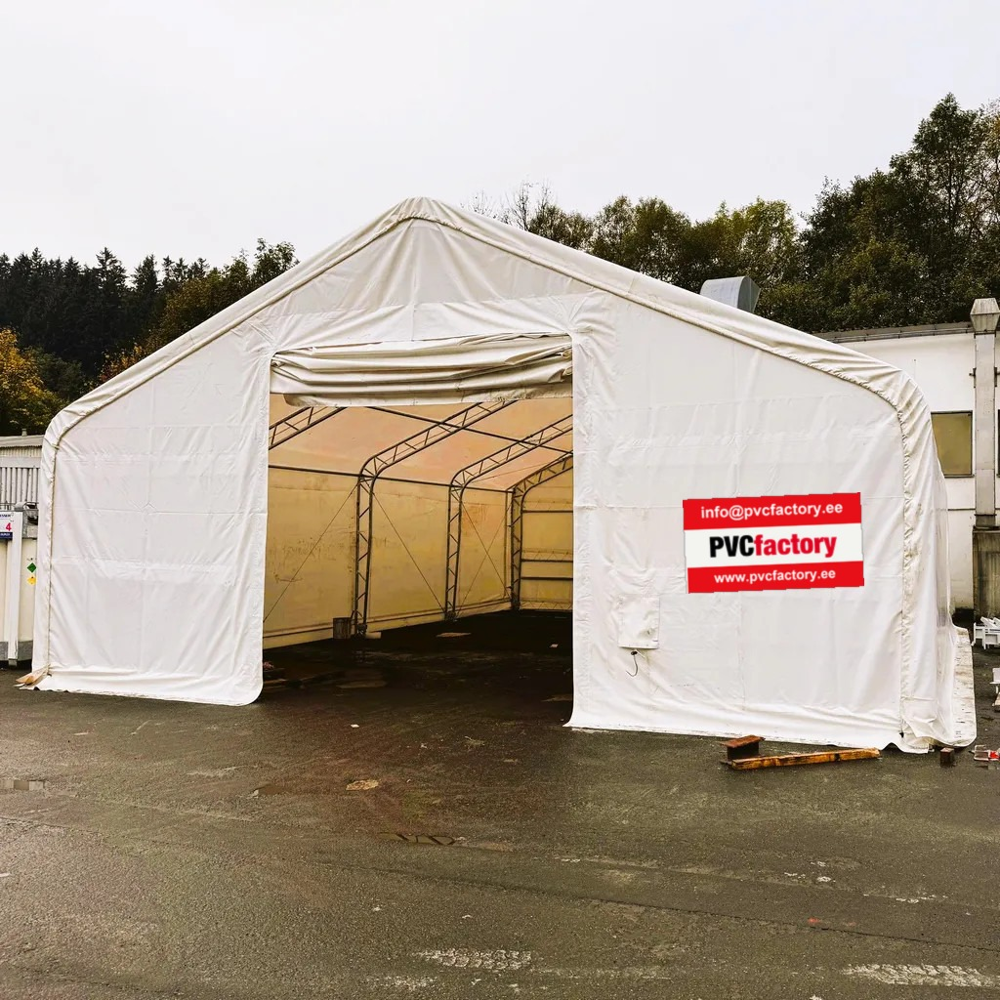

## Tehnilised andmed

| Näitaja | Väärtus |
| --- | --- |
| Laius | 9,15 m |
| Pikkus | 12,20 m |
| Põrandapind | ~111,6 m² |
| Harja kõrgus | 6,10 m |
| Külgseina kõrgus | 3,80 m |
| Värava ava (laius × kõrgus) | 4,00 × 4,50 m |
| Sissesõiduväravaid | 2 (üks kummaski otsaseinas) |
| Kaarte vahe | 3,05 m |
| Kaarte arv | 5 (2 otsakaart + 3 vahekaart) |
| Kaare toru | Ø 48 × 1,5 mm |
| Roovi (pikitala) toru | Ø 48 × 1,5 mm |
| Raam | topelt-sõrestik, tsingitud teras |
| Kate | PVC 900 g/m², raskesti süttiv (klass B1) |
| Katte rebenemistugevus (EN ISO 13934-1) | 3600 N |
| UV-kaitse (EN 13758-1:2007) | UPF 50+ |
| Lumekoormus | 0,28 kPa (≈ 28 kg/m²) |
| Max tuule kiirus | 80 km/h |
| Katte värvid | valge, roheline |
| Katte pingutus | pingutustorud taskutes + transpordirihmad pingutitega |
| Kinnitus alusele | alusplaadid; pinnasel vaiad (kaldu), kõval alusel tüüblid/ankrupoldid |

Märkused:

- Tootelehe joonisel (pilt 10) on lumekoormus **0,23 kPa**, tehnilises tabelis ja paigaldusjuhendis **0,28 kPa**. Enne müüki hankijalt üle küsida.
- Tootelehe lühikirjeldus mainib mudelit „9,15 × 9,15 m GS303020“ – see on hankija kopeerimisviga, toode on 9,15 × 12,2 m.

## Hankija info (inamiot.pl, 21.10.2026)

| | |
| --- | --- |
| Hind | 23 088,62 zł + KM (28 399,00 zł koos 23% KM-ga) |
| Transport | 3 419,40 zł koos KM-ga, veoautoga; PL 1–2 tööpäeva, EL 1–5 päeva |
| Laoseis | 3 tk; laost otsas olles tarne ~4–5 kuud |
| Varuosad | saadaval 5 aastat ostust |

## Pildid

| | |
| --- | --- |
|  Eestvaade, värav avatud | 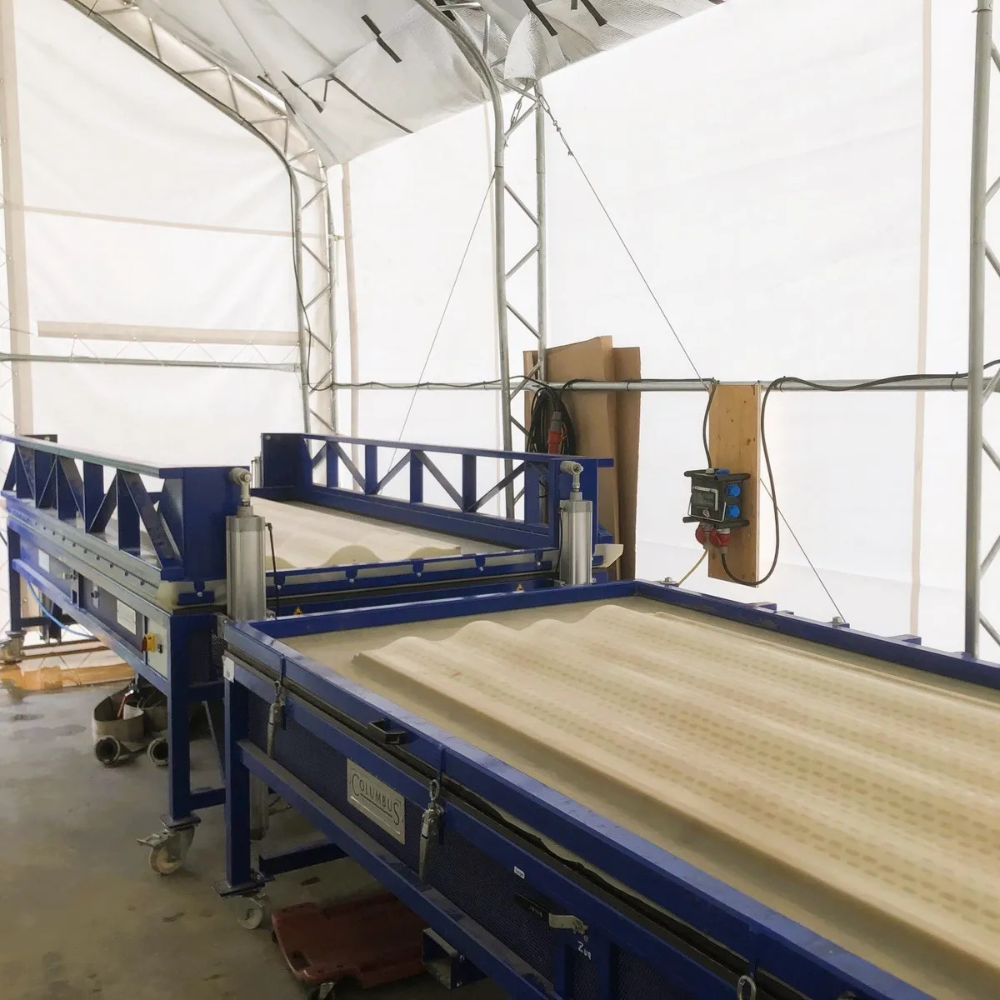 Sisevaade, kasutus tootmisliiniga |
| 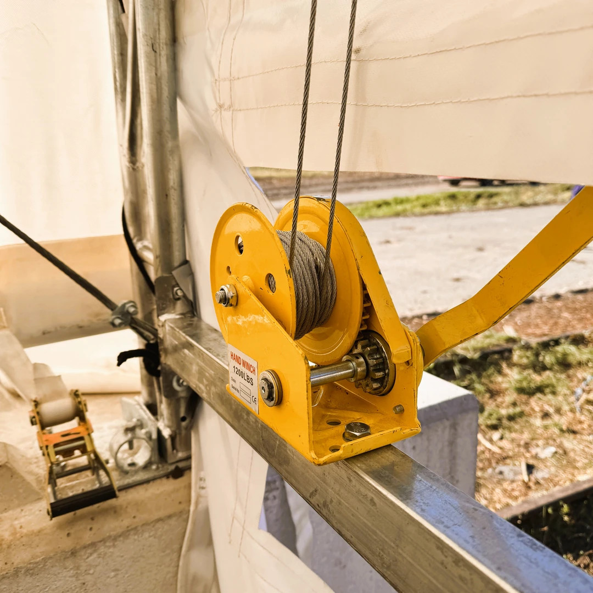 Värava käsivints | 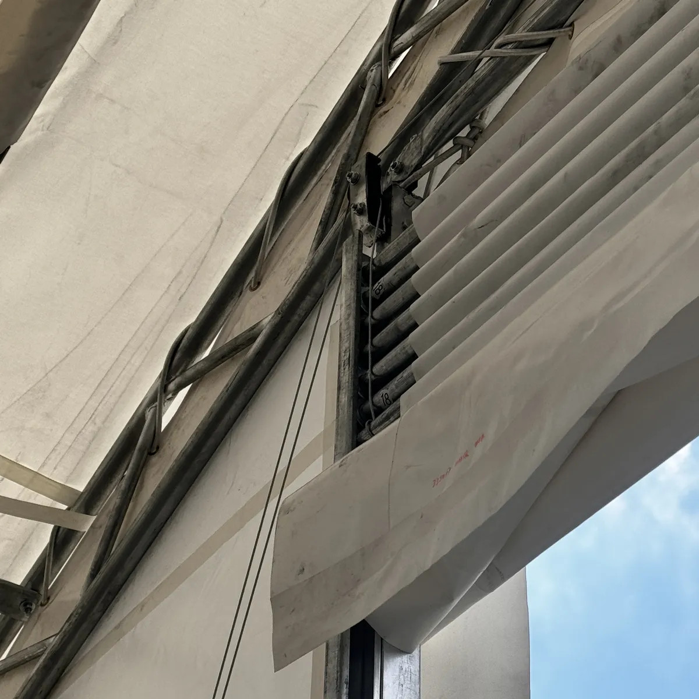 Üles rullitud väravakate sõrestiku all |
| 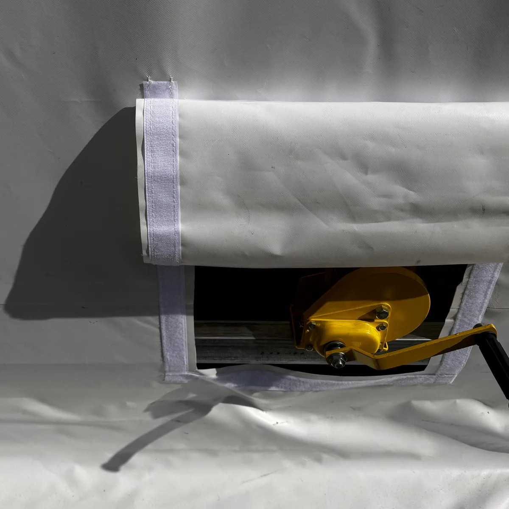 Vints kaitseklapi all | 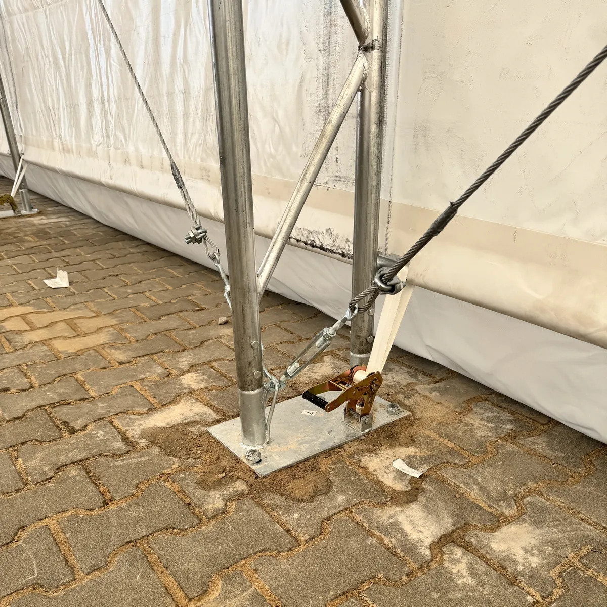 Sõrestikpost, alusplaat ja diagonaaltrossid |
| 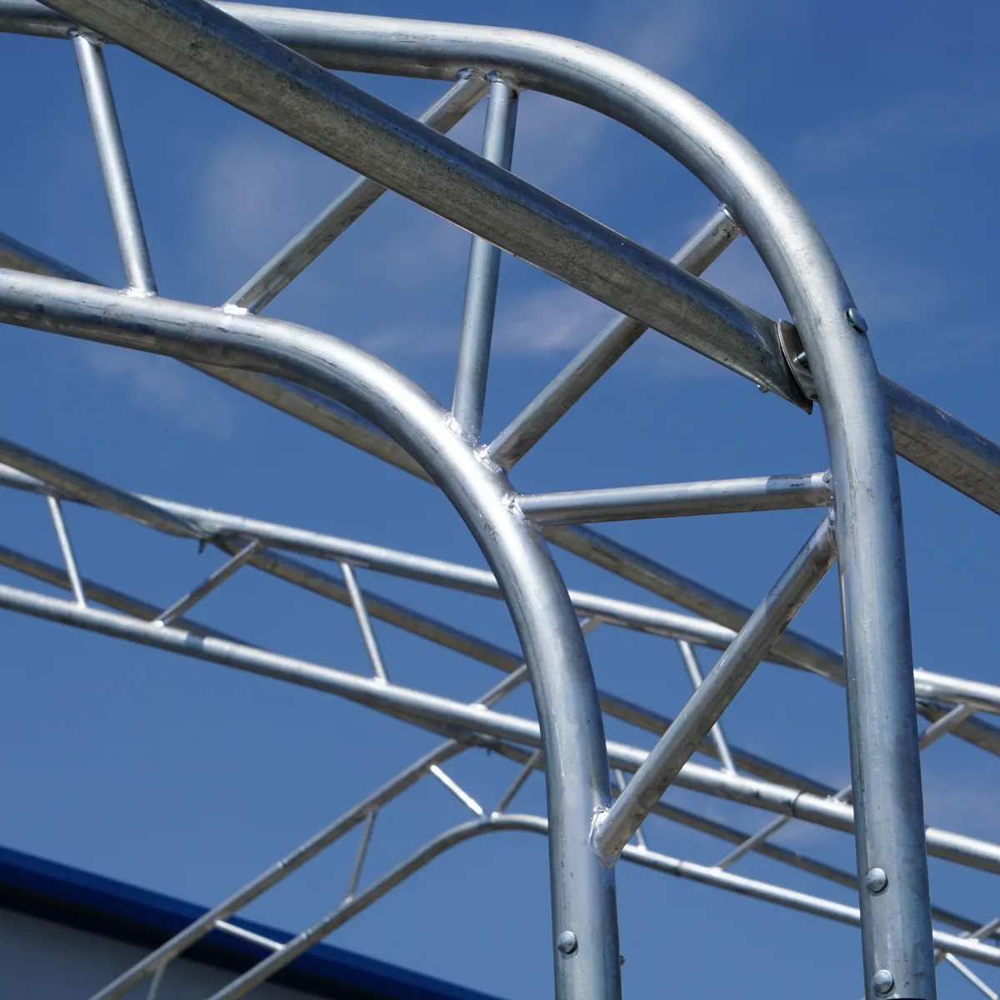 Tsingitud sõrestik räästa juures | 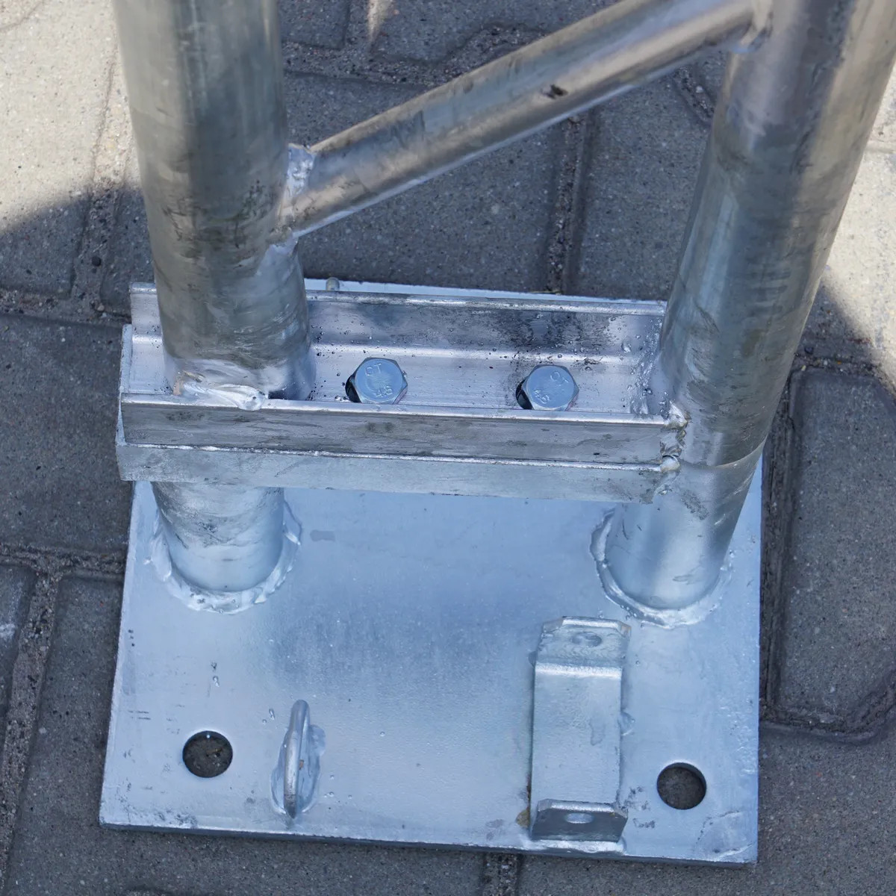 Tsingitud alusplaat |
| 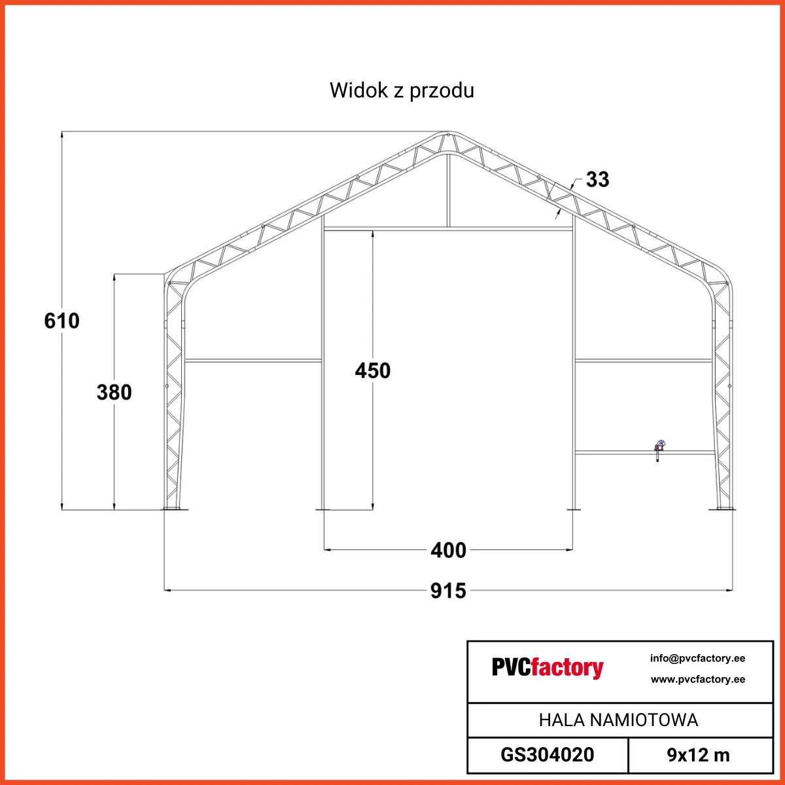 Joonis, eestvaade mõõtudega (cm) | 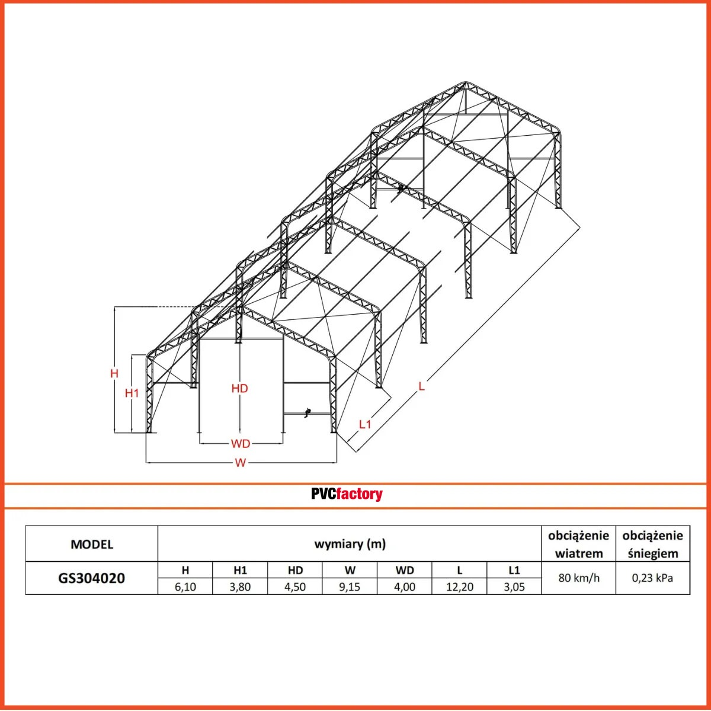 Joonis, perspektiiv ja mõõtude tabel |
|  PVC kate 900 g/m², roheline |  PVC kate 900 g/m², valge |

## Komplekti osad (GS304020)

| Kood | Osa | Kogus |
| --- | --- | --- |
| 1 | Katuseraami ülemine toru | 3 |
| 1A | Katuseraami ülemine toru, esimene/viimane kaar | 2 |
| 2 | Katuseraami alumine toru | 6 |
| 2A | Katuseraami alumine toru, esimene/viimane kaar | 4 |
| 3 | Kaare toru (õlg) | 10 |
| 4 | Külgseina toru (jalg) | 6 |
| 4A | Külgseina toru (jalg), esimene/viimane kaar | 4 |
| 5 | Roov (pikitala) | 36 |
| 6L | Nurga alusplaat, vasak | 2 |
| 6R | Nurga alusplaat, parem | 2 |
| 7 | Külgseina alusplaat | 6 |
| – | Paigaldatud kinnituspõrkmed | 10 |
| 8 | Ukse juhtsiini aluse äärik | 4 |
| 9 | Ukse ülemine juhtsiin | 4 |
| 10 | Ukse alumine juhtsiin | 2 |
| 10A | Ukse alumine juhtsiin vintsitala poolel | 2 |
| – | Juhtsiinide ühendusplaadid (lattraud) | 4 komplekti |
| 11 | Sillus | 2 + 2 |
| 11A | Silluse vertikaaltoru | 2 |
| 12 | Otsaseina horisontaaltoru | 4 |
| 13 | Vintsi alumine tala | 2 |
| 14 | Katusekatte pingutustoru | 8 + 2 |
| 15 | Otsaseina katte pingutustoru | 4 |
| 16 | Ukse pingutustoru | 12 + 12 |
| 17 | Ukse alumine pingutustoru | 2 + 2 |
| 18 | Ukse vints | 2 komplekti |
| 19 | Alusplaadi vai | 48 |
| 20 | Katuse diagonaaltross | 8 |
| 20A | Katuse diagonaaltross | 8 |
| 20B | Külgseina diagonaaltross | 12 |
| – | Trossipingutid (vantpoldid) + trossiklambrid | 28 + 56 |
| 20C | L-kujuline plaat trossi pingutamiseks | 22 |
| 21 | Kuuskantpolt M8×65 (torude otsad) | 130 |
| 21A | Kuuskantpolt M12×30 (alusplaadid) | 44 |
| 22 | Kuuskantpolt M10×75 (uksed) | 60 |
| 23 | Kinnituspolt M10×75 (roovid) | 45 |
| – | Kuuskantpolt M10×85 (otsaseina äärikud) | 8 |
| 24 | Polt M10×30 (torukinnitus ja metallplaat) | 40 |
| 25 | Plastkork pingutustorule | 12 |
| 26 | Katusekate | 1 |
| 27 | Esi-/tagaseina kate | 2 |
| 28 | Ukse kate | 2 |
| 29 | Nöörid | 3 |
| 30 | Transpordirihmad osale nr 7 | 10 |
| 31 | Vahtpolster ja teip | 30 |
| 32 | PVC-toru | 14 + 2 |
| 33 | Transpordirihmad pingutiga | 36 |

Allikas: hankija paigaldusjuhendi osade tabel, veerg 304020 ([pilt](9x12m-GS304020/paigaldus/01-osade-nimekiri.png)). Mudeli PVC304020DP3 paigaldusjuhendis ([PDF](9x12m-GS304020/paigaldusjuhend-PVC304020DP3-et.pdf)) on osade numeratsioon ja poltide mõõdud mõnevõrra erinevad (nt M8×80, M10×90) – kontrolli tegeliku komplekti pakkelehe järgi.

## Paigaldusjuhend

Hankija juhend kehtib kogu seeriale GS30x020 (laius 9,15 m, pikkus 9,15 / 12,20 / 15,25 / 18,30 / 21,35 / 24,40 m, kõrgus 6,1 m).

### Enne paigaldust

1. Kontrolli transpordikasti sisu pakkelehe järgi.
2. Ära paigalda tugeva tuulega, märjal või ebastabiilsel pinnasel.
3. Alus peab olema kõva ja loodis, lubatud kõrvalekalle ±1 cm. Soovitus: postide alla betoonvundamendid 50 × 50 × 80 cm, armatuur 4 × Ø10 mm, rangid Ø6 mm iga 20 cm järel. Kohevale, tihendamata või liivasele pinnasele (tihedusindeks Id < 0,6) paigaldada ei tohi.
4. Pinnasevaiad lüüa kogu pikkuses maasse, kaldu.
5. Arvesta kohalike nõuetega ja kauguste nõuetega elektri-, gaasi-, veetrassidest.
6. Poltide suund: polte ei tohi paigaldada raami pealmisele küljele, kus kate peal lasub – kate saab kahjustada.
7. Kõik torude ühendused ja terastrosside otsad teibi kinni (silver tape). Kasuta kaasasolevaid polstreid raami ja katte vahel.
8. Kasuta kaitsekindaid ja tööjalanõusid; jälgi, et sõrmed ei jääks klambrite ja torude vahele.
9. Jäta telgi ümber igast küljest ruumi tõstukile / teleskooplaadurile.
10. Paigaldajad peavad olema vastava kvalifikatsiooniga.
11. Hoia tööala puhas.
12. Ära kasuta katte läheduses teravaid tööriistu.
13. Talvel paigaldades hoia katet enne paigaldust 2 päeva vähemalt +10 °C ruumis ja laota see lahti samas temperatuuris – muidu võivad tekkida murdekohad ja praod.
14. Kasuta ainult komplekti osi; osade muutmine või asendamine tühistab garantii.
15. Lumi tuleb kohe eemaldada.
16. Raamile ei tohi riputada lisakoormust – konstruktsioon on arvutatud ainult lume-, tuule- ja omakaalule.
17. Katte alumine osa allpool pingutustoru peab jääma lahti (seda ei tohi kinni suruda ega kinnitada) – sealt väljub tuuleiilide korral õhurõhk.

Tööriistad: mõõdulint, silver tape teip, kriit/marker, lood, mutrivõtmed, astmeline redel, haamer, nuga/käärid, elektritööriistad. Raami ja katuse jaoks on vaja kraanat/teleskooplaadurit ja mitut inimest.

### 1. Alusplaadid

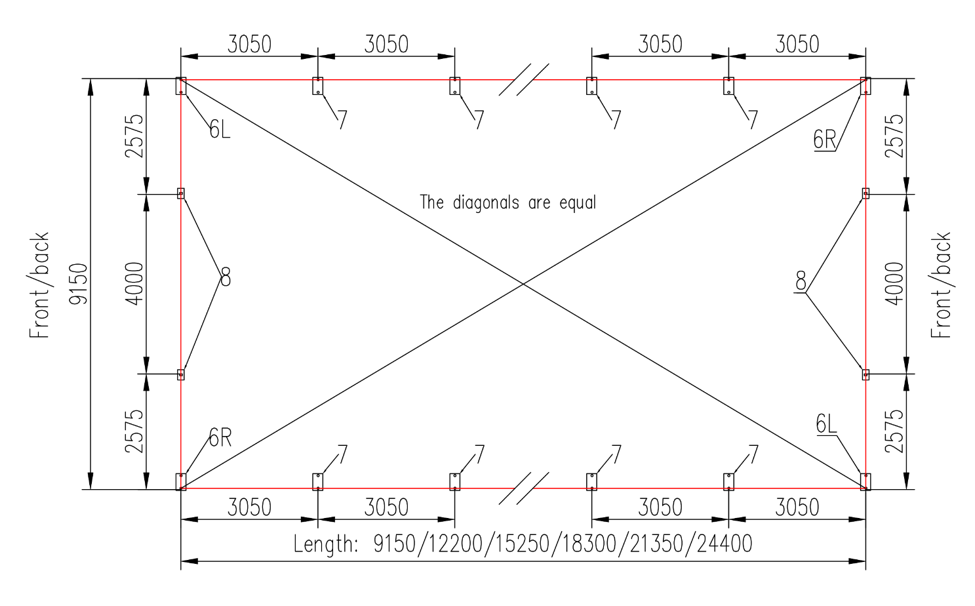

- Paigalda alusplaadid nr 7, 6L, 6R joonise järgi. Mõõdud on plaatide keskelt keskele: piki külge 3050 mm vahedega, otsaseinas 2575 + 4000 + 2575 mm. Diagonaalid peavad olema võrdsed.
- Plaadid nr 8 (ukse äärikud) paigaldatakse hiljem.
- Külgseina plaatide kinnituspõrkmed jäävad välimise, mitte sisemise toru poole.
- Plaadid peavad olema omavahel paralleelsed ja vastasplaatidega täisnurga all.
- Pinnasel kinnita vaiadega nr 19 (kaldu); kõval alusel alusele sobivate tüüblitega.

### 2. Raam

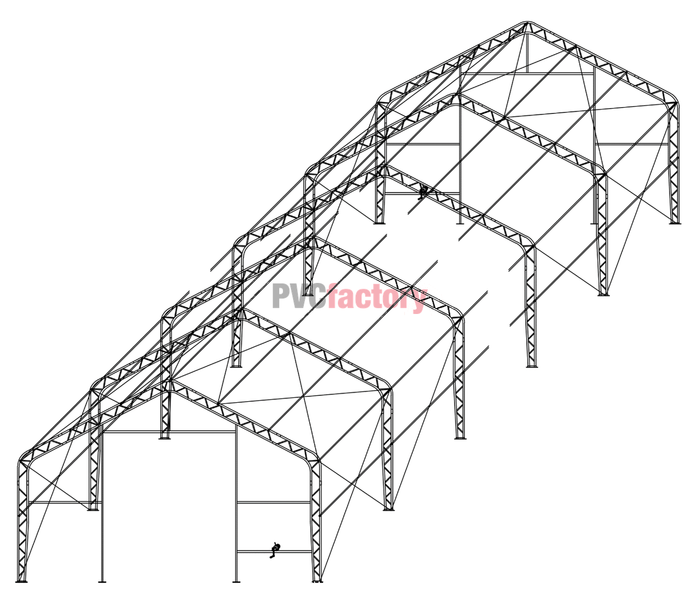

1. **Esimene ja viimane kaar:** 1 × 1A, 2 × 2A, 2 × 3, 2 × 4A, poldid nr 21 (M8×65). Ühenda osad, aseta kaar alusplaatidesse. Mutreid ära pinguta lõpuni enne, kui kogu raam on kokku pandud ja paigas.
   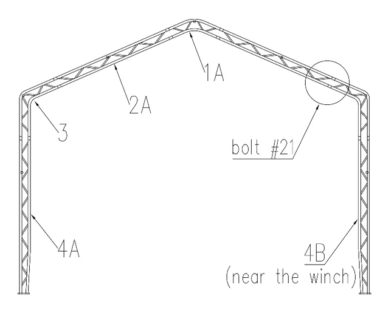
2. **Vahekaared:** 1 × 1, 2 × 2, 2 × 3, 2 × 4, poldid nr 21 – samamoodi. Otsakaarte ja vahekaarte sektsioonid on erinevad.
   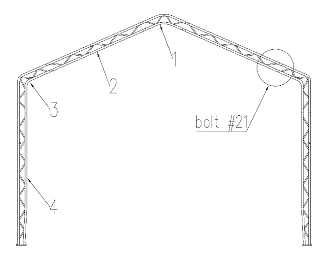
3. **Kaarte püstitamine:** tõsta esimene kaar aeglaselt kraanaga (vähemalt 3 tõstepunkti), aseta nurgaplaatidele 6L ja 6R, kinnita poltidega. Toesta kaar köite/kraanaga, kuni see seisab stabiilselt. Seejärel tõsta samamoodi esimene vahekaar.
   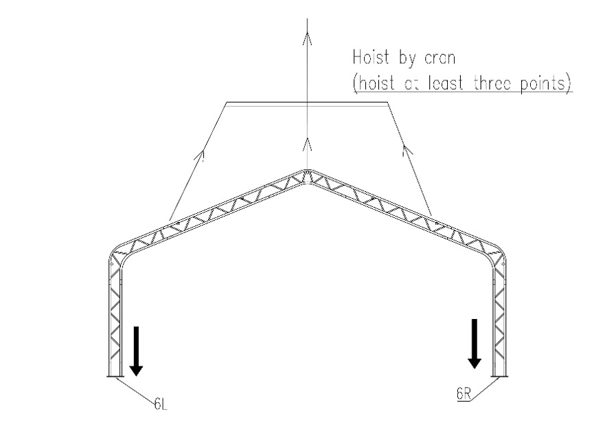
4. Ühenda kaks esimest kaart roovidega nr 5, poldid nr 23 (osade tabeli järgi M10×75; hankija juhendi tekstis on kirjas M8×65). Jätka järgmiste kaartega.
   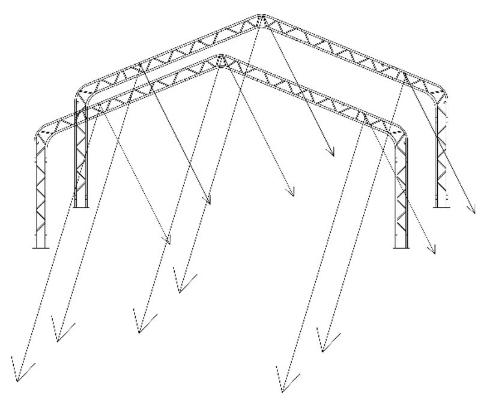
5. **Diagonaaltrossid:** katusele nr 20/20A, külgseintele nr 20B; trossi pingutamiseks L-plaat nr 20C. Kui kõik trossid on paigas, pinguta vantpolte kergelt, et kaared loodida ja raam jäigastada.
   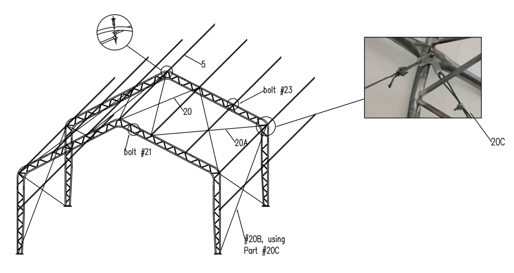
6. Mähi kaarte ühenduskohad teibiga (silver tape).
   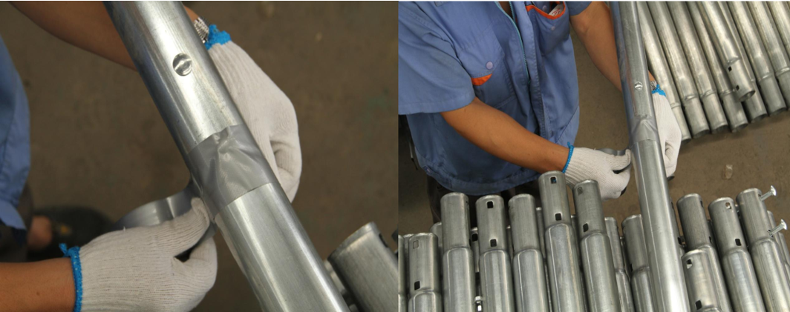

### 3. Esi- ja tagasein

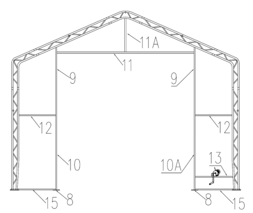

- Paigalda ukse juhtsiinid nr 9, 10 (või 10A).
- Pane kokku sillus nr 11 ja silluse vertikaaltoru nr 11A.
- Paigalda horisontaaltorud nr 12.
- Pane kokku vintsitala nr 13.
- Ühenda äärikutega nr 8, kinnita need vaiadega.
- Paigalda pingutustoru nr 15.
- Teibi kõik torude ühendused. Lõpuks paigalda otsaseinte diagonaalid.

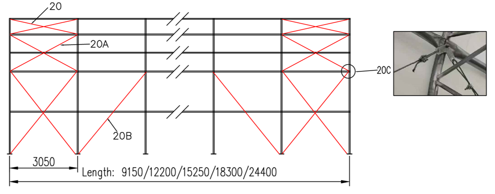

Kui kõik trossid 20B on paigas, pinguta vantpolte kergelt. **Kontrolli kogu raami täisnurksust ja loodis olekut**, vajadusel reguleeri, seejärel pinguta raami poldid. Ära pinguta üle – ovaalsed raamiosad ei tohi lömmi minna. Teibi kõik kohad, kus osad võivad katet hõõruda.

### 4. Kate

1. Kinnita esi- ja tagaseina katted nööriga nr 29 läbi katte aasade, ühtlaselt ja tugevalt.
   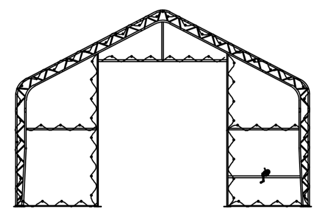
2. Katusekatte jaoks on vaja mitut inimest ja tõstukit (nt teleskooplaadur). Talvel soojenda katet eelnevalt (vt eespool). Ära paigalda tugeva tuulega. Kontrolli enne, et kõik toruühendused on teibitud.
   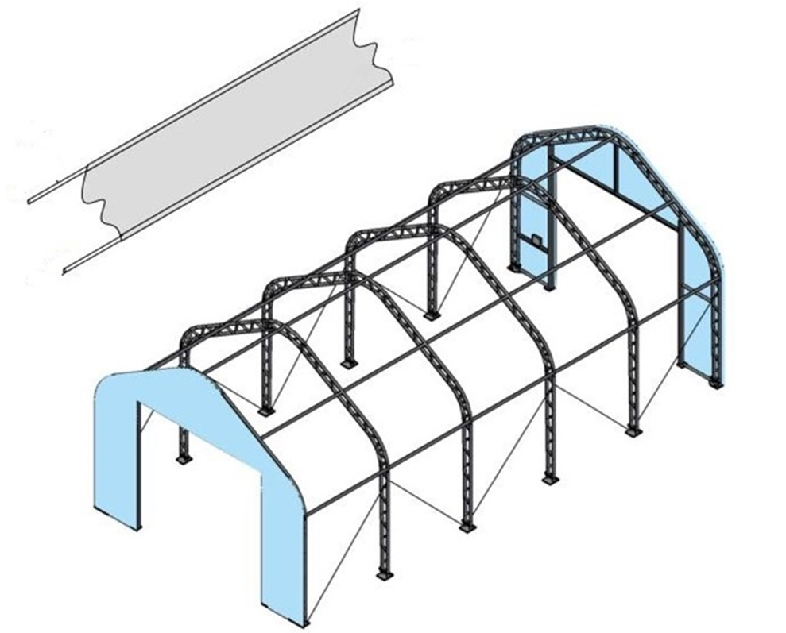
3. Laota katusekate lahti telgi ühele küljele. Pane terastorud (nr 14) katte taskutesse. Lõika taskusse u iga 3 m järel väike ava ja seo sinna nöör. Iga nööri juurde üks inimene. Viska nöörid üle raami ja tõmba kate aeglaselt ja ühtlaselt üle raami. Üks inimene jälgib seest, et kate raami külge kinni ei jääks. Pärast tõmbamist seo kate nurkadest raami külge ja joonda ette-taha ning külgedele.
   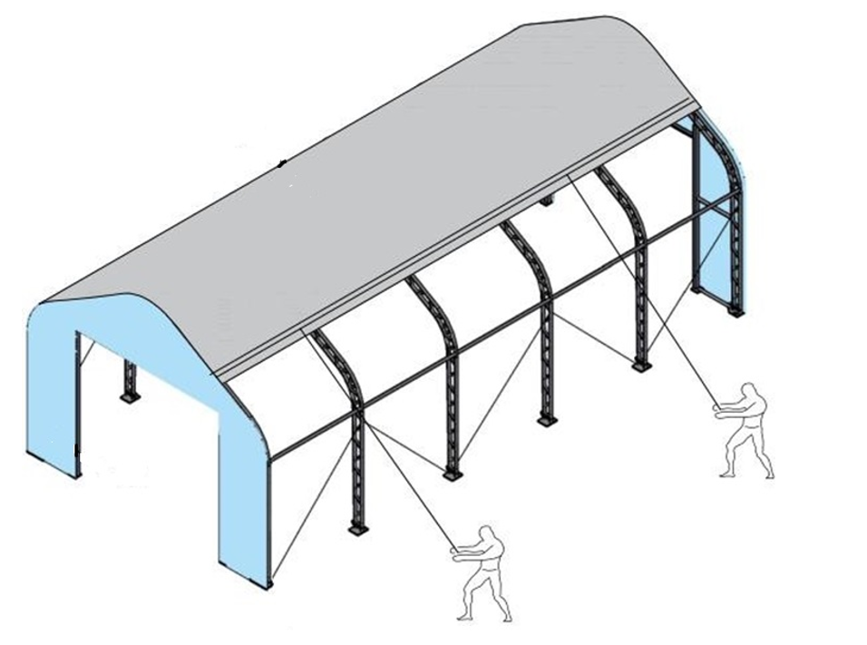
4. Pane PVC-torud katte esi- ja tagaosa taskutesse. Joonda kate ette/taha, siis vasakule/paremale. Pinguta ette/taha, siis vasakule/paremale.
   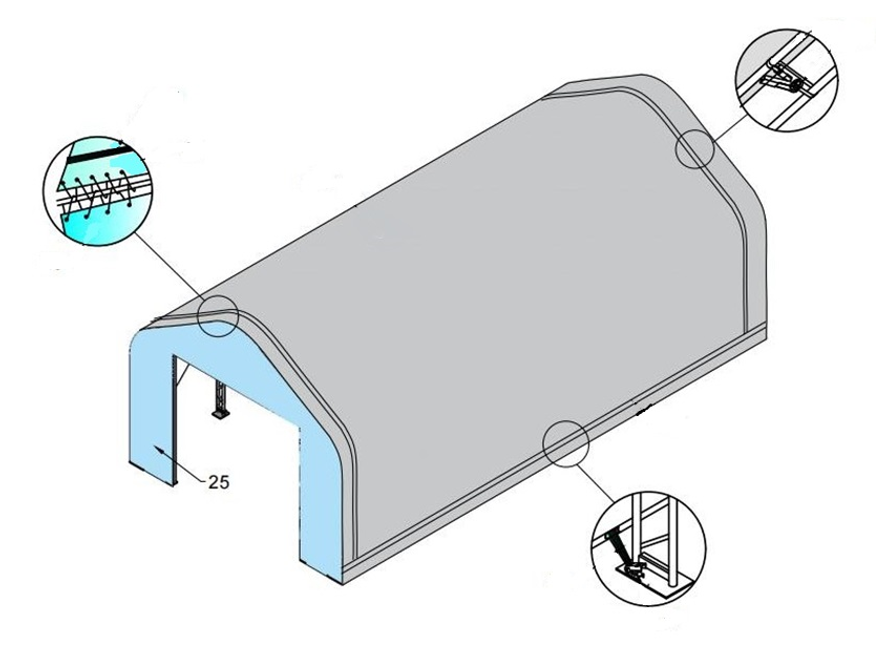
5. Pinguta katet transpordirihmadega joonise järgi. Komplektis on mitu eri tüüpi rihma ja pingutit eri kohtade jaoks.
   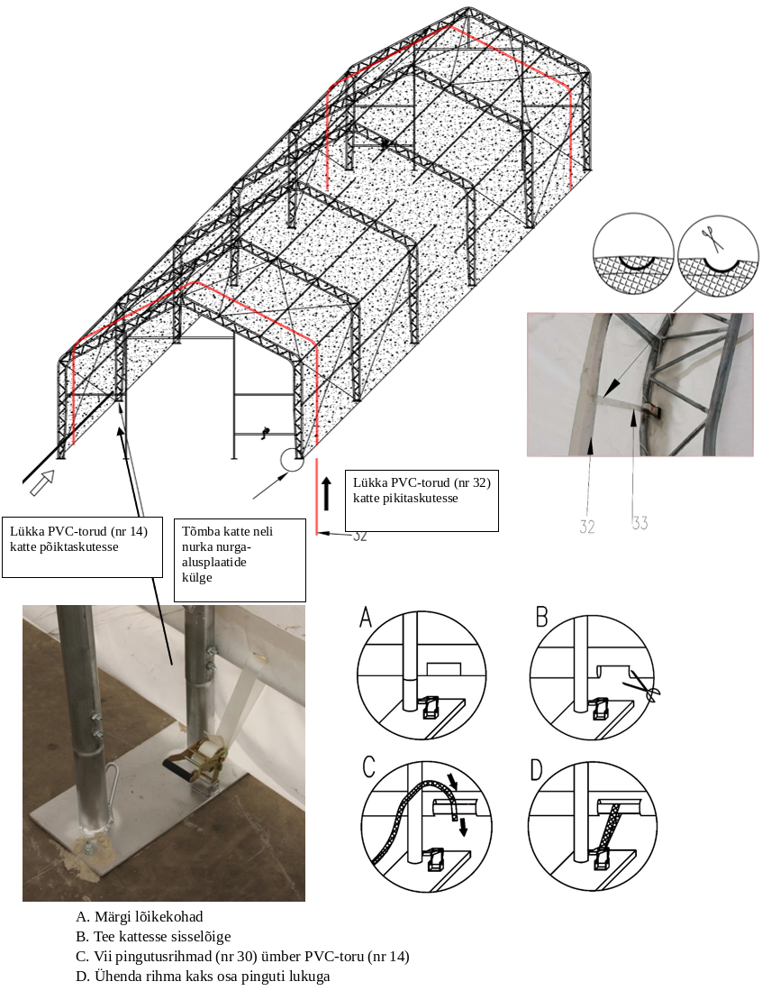
6. Pane pingutustorude otstesse plastkorgid.

### 5. Väravad

1. Kinnita vintsimehhanism nr 18 esipaneeli alumise tala nr 13 külge.
2. Lükka ukse pingutustorud nr 16 ja nr 17 ukse katte taskutesse.
3. Juhtsiinide **alumisest** otsast tõsta ukse katet ettevaatlikult ja lükka ukse torud juhtsiinidesse.
4. Paigalda vintsist kaks terastrossi:
   - **lühem tross:** läbi topeltratta alumise rulli juhtsiini ülaosas, alla ukse alumise pingutustoru avasse, seo sõlme;
   - **pikem tross:** läbi topeltratta ülemise rulli, üle teise juhtsiini üksikrulli, alla ukse alumise toru avasse, seo sõlme.
5. Tõsta ja lase väravat mõned korrad, et torude otsad juhtsiinides kinni ei jääks; vajadusel määri.

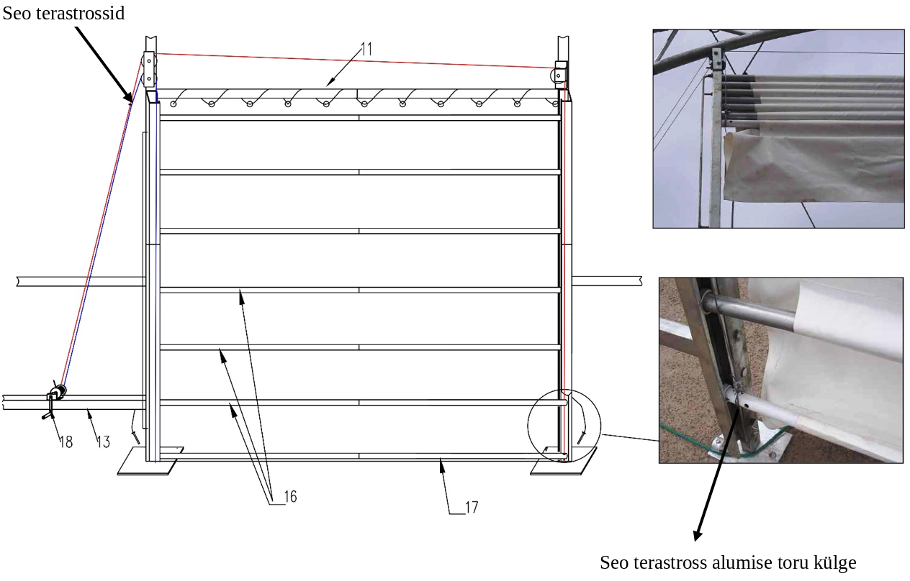

**Katusekatet ei tohi mingil juhul jätta kinnitamata enne lõplikku paigaldust ja pingutamist.** Lameda ja pingul katuse saamiseks on vaja järelpingutusi. Kontrolli katust vähemalt kord kuus.

### Kasutamine ja hooldus

- Taga piisav ventilatsioon heitgaaside ja ohtlike aurude jaoks.
- Kütteseadmed ja muud soojusallikad vähemalt 2 m kaugusel kattest; lahtist tuld mitte.
- Orkaani korral eemalda kate.
- Kontrolli kinnitust alusele vähemalt kord kuus ja pärast iga tuult üle 50 km/h.
- Pinguta katuskatet rihmadega piisavalt, et katusele ei tekiks „võrkkiike“. Pinguta 1–2 korda üle mõne kuu pärast, eriti kui paigaldati külmaga (sügis/talv) – soojaga kate lõtvub.
- Lumi tuleb kohe eemaldada, kui see ise maha ei libise (omaniku kohustus).
- Transpordirihmad ja kummiosad on kuluosad – kontrolli kord kuus, vaheta vajadusel.
- Pesemiseks lahja pesuvahendi lahus, mis PVC-d ei kahjusta; survepesur ainult madala survega ja ohutust kaugusest.
- Lahtivõtmisel kasuta pakkelehte. Märga katet kokku ei pakita.

## Videod ja lisamaterjal

- Hankija paigaldusvideo (sama seeria hall): https://www.youtube.com/watch?v=h_OFFdm0VoI – „Instrukcja Montażu Hali Namiotowej“
- Eestikeelne paigaldusjuhend, mudel PVC304020DP3 (PDF, joonistega): [paigaldusjuhend-PVC304020DP3-et.pdf](9x12m-GS304020/paigaldusjuhend-PVC304020DP3-et.pdf)
- Hankija paigaldusjuhend veebis (poola k): https://inamiot.pl/instrukcja-montazu-hali-namiotowej
- Sarnane 30′ × 40′ viilkatusega laohall, kokkupanek (teine tootja, mitte identne raam): https://www.youtube.com/watch?v=MbZsmB06kTQ
