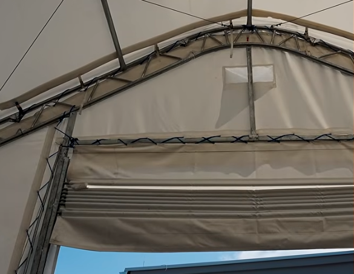

# PVC3040203 – otsaseina/värava katte kinnitus, pakend ja transport

Vastus kliendi küsimustele (telk 9,15 × 12,2 m, vt [tooteleht](9x12m-GSPVC3040203.md) ja
[paigaldusjuhend](9x12m-GS304020/paigaldusjuhend-PVC304020DP3-et.pdf)).
Allpool on esmalt kliendile saatmiseks valmis tekst, seejärel sisemärkmed.

---

## Vastus kliendile

Tere!

Aitäh küsimuste eest. Vastan järjekorras.

**1. Kuidas ukse/otsaseina PVC kinnitub?**

Kummidega mitte – kinnitus on **köiega punumine** (nöör on komplektis, osa nr 29).

- Otsaseina katte servades on **metallrõngastega aasad** (läbiviigud). Läbi nende punutakse
  köis siksakiliselt ümber raami torude: ümber otsakaare, ukse juhtsiinide (värava külgpostid),
  silluse (värava ülatala) ja otsaseina horisontaaltorude. Pildil näha must siksak on just see
  köis. Kõigepealt sobitatakse kate ümber raami ja alles siis pingutatakse köis ühtlaselt.
- Katte alumises servas on taskus terastoru (pingutustoru), mis hoiab serva sirge ja pingul.
- **Värav ise** (ülesrulluv kate) ei ole köiega kinni: kattes on taskutes mitu horisontaalset
  toru, mille otsad liiguvad külgmistes juhtsiinides. Vintsi kaks terastrossi tõstavad
  alumist toru ja kate rullub üles. Suletud väravat hoiavad sirgena juhtsiinid ja alumise toru
  raskus.
- **Terastrossid** (pildil peenikesed jooned diagonaalis) on raami diagonaaltugevdused – need
  jäigastavad raami, katet nad ei kinnita. Värava juures on lisaks vintsi tõstetrossid.
- Katusekate kinnitub pikkade külgedega taskutes olevate torude ja põrkmerihmadega (36 tk),
  esi- ja tagaservast samuti köiega punudes ümber esimese ja viimase kaare.

**2. Pakend – kas iga pakk on üksi tõstetav?**

Ei ole. Tehas saadab kogu komplekti **ühes terasest transpordikastis (raamkastis)**, mitte
mitme väikese pakina. Tehas ise täpseid kasti mõõte ja kaalu avalikult ei anna – küsime
need tehasest kirjalikult üle. Sama klassi 9 × 12 × 6 m topeltsõrestikhallide järgi on
orienteeruvad andmed:

| | Orienteeruvalt |
| --- | --- |
| Pakkeid | 1 terasest raamkast |
| Mõõdud (P × L × K) | ~3,1 × 1,1 × 0,9–1,0 m |
| Kaal kokku | ~1,4–1,6 t |
| Raskeim üksik detail | katusekate rullis, ~200–250 kg |
| Pikimad torud | ~3 m |
| Laadimine | ainult tõstuki, teleskooplaaduri või kraanaga (HIAB) |

Kasti lahti tehes on üksikud torud ja sõrestikuosad 1–2 inimesega käsitsi tõstetavad,
katusekate (~200+ kg) vajab 4–6 inimest või tõstukit.

**3. Transport Tartust Haapsallu või ise kaubikuga järgi**

Vahemaa on ~260–290 km. Kaks varianti:

- **Veofirma.** Kõige lihtsam on kraanaga veok (HIAB), mis tõstab kasti ise maha – siis pole
  Teil kohapeal vaja tõstukit. Tavaline grupiveos (ilma kraanata) on odavam, aga mahalaadimiseks
  on vaja tõstukit/traktorit kahvlitega või teleskooplaadurit (selle vajate niikuinii
  paigalduseks, nii et saab sama masinaga ka kasti maha tõsta). Hinnapakkumise jaoks vajab
  veofirma: kasti mõõdud ja kaal (tabel üleval), 1 koht, mittevirnastatav, pealelaadimine
  tõstukiga Tartus, mahalaadimise viis Haapsalus (kraana või kliendi tõstuk), aadress ja
  kuupäev. Küsime Teile soovi korral pakkumise.
- **Ise kaubikuga.** Terve kast (~1,5 t) on tavalise 3,5 t kaubiku kandevõime (~1,0–1,4 t)
  jaoks üldjuhul **liiga raske** ja ülekoormatud kaubikuga sõita ei tohi. Variandid:
  - kast avatakse Tartus ja osad laaditakse käsitsi kaubikusse (kaubiku kaubaruum vähemalt
    ~3,2 m pikk); sõltuvalt kaubiku kandevõimest tuleb ilmselt **kaks reisi** või kaubik +
    haagis (arvestage juhiloa kategooriaga – B-kategooriaga autorong kuni 3,5 t);
  - Tartus aitame laadida tõstukiga; Haapsalus on vaja inimesi või masinat mahatõstmiseks.

Kokkuvõttes on veoauto kraanaga ühe korraga ilmselt kõige vähem vaeva. Kaubikuga on võimalik,
aga mitme reisi ja käsitsi tõstmisega.

Lugupidamisega
PVCfactory.ee

---

## Sisemärkmed (mitte saata)

- **Allikad.** Kinnitus: paigaldusjuhendi joonised 12 (otsaseina katted köiega), 17 (värav),
  18 (foto); osade tabel – nöörid nr 29, pingutustorud nr 15/16/17, põrkmerihmad nr 33.
  Komplektis ei ole kummitroppe (bungee). Pakend: inamiot.pl/dostawa ütleb „skrzynia
  stalowa“, vajab mahalaadimise tehnikat; mõõtu/kaalu tootelehel pole.
- **Mõõdud ja kaal on hinnang**, mitte tehase andmed. Võrdlus: Gold Mountain 30′×40′×20′
  topeltsõrestik – 1 kast 123 × 43 × 36″ (3,12 × 1,09 × 0,91 m), 1175 kg (16 oz PVC) /
  1420 kg (23 oz ≈ 780 g/m²), tõstuk vajalik
  ([cheryindustrial.com](https://www.cheryindustrial.com/collections/gold-mountain/products/gold-mountain-double-truss-arch-storage-shelter-w30xl40xh20)).
  Meie kate on 900 g/m², seega pigem ülemine ots. Katte pind ~310–340 m² × 0,9 kg ≈ 300 kg
  kokku, sh katusekate ~220 m² ≈ 200 kg.
- **Hankijalt küsida:** kasti täpsed mõõdud ja brutokaal, kas kast on üks või mitu,
  tagastatav või mitte, katusekatte rulli kaal.
- Laoaadress Tartus ja tõstuki olemasolu – kontrollida enne kliendile kinnitamist.
- Veohinda pole kirja pandud – küsida pakkumine pärast tehase kaalu saamist.
